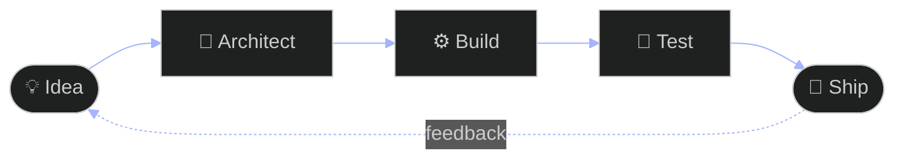

<!-- ═══════════════════════ HERO ═══════════════════════ -->

<div align="center">


<a href="https://github.com/kaiden-A">
  
</a>

<br/><br/>


<br/><br/>

<a href="https://github.com/kaiden-A"></a>
<a href="https://www.linkedin.com/in/amirul-ikhwan-041772390"></a>
<a href="https://elysiaa.com"></a>
<a href="mailto:contacts@elysiaa.com"></a>

</div>

<br/>

<!-- ═══════════════════════ ABOUT ═══════════════════════ -->


<table>
<tr>
<td width="55%" valign="top">

I'm **Kaiden-A**, a Computer Science student at **IIUM**, specializing in **Artificial Intelligence**.

I love taking an idea from rough sketch to deployed product: designing the architecture, building the backend, wiring in AI, and shipping it.

Right now I'm obsessed with where **full-stack engineering**, **AI-powered apps** and **systems design** meet.

</td>
<td width="45%" valign="top">

```ts
const kaiden = {
  school:  "IIUM · Computer Science",
  major:   "Artificial Intelligence",
  focus:   ["AI apps", "Full-stack", "Systems"],
  values:  ["First principles",
            "Clean architecture",
            "Shipping real things"],
  status:  "Building in public 🚀",
};
```

</td>
</tr>
</table>

### 🔁 How I work



<br/>

<!-- ═══════════════════════ SELECTED WORK ═══════════════════════ -->


<table>
<tr>
<td width="50%" valign="top">

### ✦ Elysiaa


**An interconnected software ecosystem.** Applications, AI-powered experiences and developer tools under one roof.

  

**[Explore Elysiaa →](https://elysiaa.com)**

</td>
<td width="50%" valign="top">

### ✦ Elpis


**An AI assistant with real tools.** An agentic project exploring MCP and integrations, so assistants can *do* more than generate text.

  

**[View repositories →](https://github.com/kaiden-A?tab=repositories)**

</td>
</tr>
<tr>
<td width="50%" valign="top">

### ✦ Solace


**A garden for your thoughts.** A digital-garden concept that turns reflection into an interactive, personal experience.

  

**[Visit Solace →](https://solace.elysiaa.com)**

</td>
<td width="50%" valign="top">

### ✦ Student Systems


**Software for real student communities.** Management and booking systems built for student organisations.

  

**[View repositories →](https://github.com/kaiden-A?tab=repositories)**

</td>
</tr>
</table>

<br/>

<!-- ═══════════════════════ TOOLKIT ═══════════════════════ -->


<div align="center">

<table>
<tr><td align="center"><b>🗣️ LANGUAGES</b></td>
<td></td></tr>
<tr><td align="center"><b>🎨 FRONTEND</b></td>
<td></td></tr>
<tr><td align="center"><b>⚙️ BACKEND</b></td>
<td></td></tr>
<tr><td align="center"><b>🧠 DATA & AI</b></td>
<td></td></tr>
<tr><td align="center"><b>🗄️ DATABASES</b></td>
<td></td></tr>
<tr><td align="center"><b>🚢 DEVOPS</b></td>
<td></td></tr>
</table>

</div>

<br/>

<!-- ═══════════════════════ ACTIVITY ═══════════════════════ -->


<div align="center">


<br/>


<br/>


<br/>

<!-- Snake: needs the workflow in .github/workflows/snake.yml -->
<picture>
  <source media="(prefers-color-scheme: dark)" srcset="https://raw.githubusercontent.com/kaiden-A/kaiden-A/output/github-snake-dark.svg" />
  <source media="(prefers-color-scheme: light)" srcset="https://raw.githubusercontent.com/kaiden-A/kaiden-A/output/github-snake.svg" />
  
</picture>

</div>

<br/>

<!-- ═══════════════════════ CONNECT ═══════════════════════ -->


Into AI, software engineering or educational tech? Got an idea that needs building? Let's talk.

<div align="center">

<a href="https://github.com/kaiden-A"></a>
<a href="https://www.linkedin.com/in/YOUR-LINKEDIN"></a>

<br/><br/>


</div>
